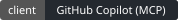
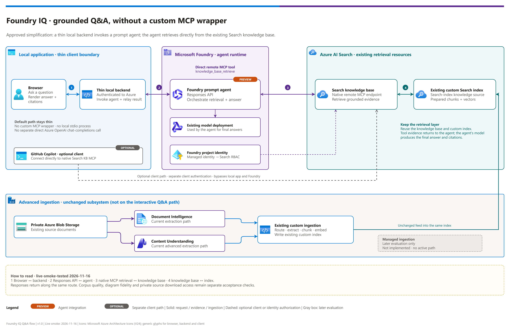
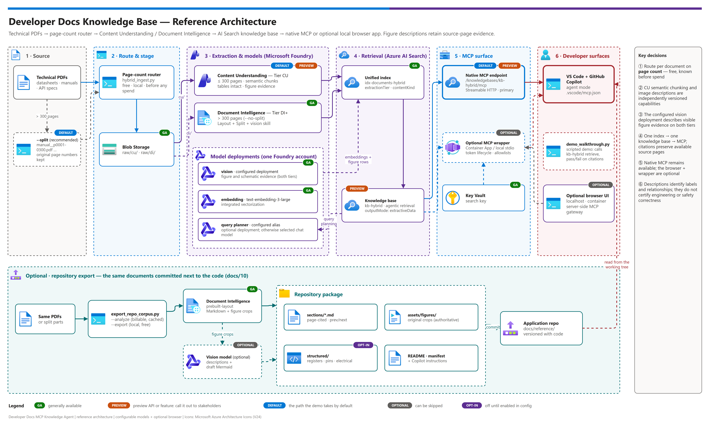
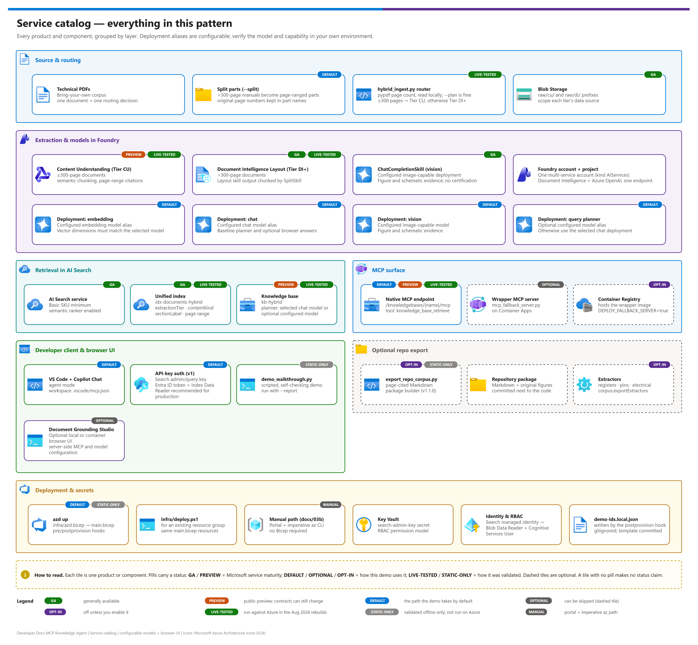

# Developer Docs Copilot Grounding

> Formerly published as `dev-docs-mcp-kb-agent`. Old links redirect automatically.

<p align="center">
  &nbsp;
  &nbsp;
  &nbsp;
  &nbsp;
  &nbsp;
  &nbsp;
  &nbsp;
  
</p>

<p align="center">
  
  
  
  
  
  
  
  
</p>

> [!WARNING]
> **For testing and demonstration purposes only.** This is a personal reference demo provided "as is" under the [MIT License](LICENSE), without warranty or support. It is not an official Microsoft product or sample, has not been through a production security review, and is not intended for production use. Review, test, and harden it before reusing any part of it, deploy only to non-production subscriptions, and never use real customer or personal data.

**Ask your developer documentation through Foundry IQ, or ground GitHub Copilot directly.**
The default browser Q&A path now uses a Microsoft Foundry prompt agent connected
to the existing Azure AI Search knowledge base through its native MCP endpoint.
It removes the local MCP wrapper and separate direct-model call from browser Q&A.
GitHub Copilot and other MCP clients can still call the knowledge base directly.
The existing PDF ingestion pipeline is retained.

## Foundry IQ Q&A - start here

[](./docs/assets/foundry-iq-qa-flow.png)

<sub>Editable source: [foundry-iq-qa-flow.drawio](./docs/assets/foundry-iq-qa-flow.drawio).</sub>

| Experience | Path | Recommendation |
|---|---|---|
| Browser document Q&A | Browser > thin gateway > Foundry prompt agent > Foundry IQ > existing index | Default; cited answers and follow-up context |
| Coding assistant | GitHub Copilot > native knowledge-base MCP endpoint | Retained direct integration |
| Retrieval diagnostics | Browser > custom MCP wrapper > Search | Explicit diagnostic/legacy path only |

With an existing indexed corpus and the intended demo tenant/subscription selected:

```powershell
python scripts\configure_foundry_iq.py --ids-file demo-ids.local.json --knowledge-base kb-hybrid
.\scripts\start_qa.ps1 -Python <path-to-configured-python.exe>
```

See [13 - Foundry IQ Q&A](./docs/13-foundry-iq-qa.md) for authentication,
dependencies, permissions, the portal/manual path and deployment readiness.
The Foundry connection is preview. Agent setup, cited answers and a follow-up
were live-smoke-tested on 2026-11-16; see [the evidence](./docs/04-testing.md#2026-11-16--foundry-iq-qa).
Foundry does not automatically host a browser website.

## At a glance

| | Item | Value |
|---|---|---|
|  | **Who consumes it** | GitHub Copilot in VS Code (agent mode) or any MCP-compatible client, through a workspace `.vscode/mcp.json`. |
|  | **Retrieval** | AI Search Knowledge Base with agentic retrieval, exposed through its **native MCP endpoint** (`/knowledgebases/{name}/mcp`).   Live-tested. |
|  | **Ingestion** | Two tiers routed by page count: Content Understanding (≤ 300 pages)  and Document Intelligence Layout (> 300 pages, or `--split` parts) , landing in one unified index. |
|  | **Models** | `embedding`, `chat`, `vision` (figure evidence), plus an optional explicitly selected `frontier` planner. Browser answer generation uses its own configured deployment. |
|  | **Optional wrapper** | A custom Python MCP server on Container Apps for token lifecycle, custom processing or IP allowlisting.  |
|  | **Browser Q&A** | Answer-first Foundry-agent client with citations and follow-ups; see [Foundry IQ Q&A](./docs/13-foundry-iq-qa.md). |
|  | **Optional PDF uploader** | Authenticated Container App uploads through a private Blob endpoint; see [uploader/README.md](./uploader/README.md). No direct workstation Storage connection is needed. |
|  | **Deploy with** | `azd up`   — or `infra/deploy.ps1`, or the manual Portal path in [docs/03b](./docs/03b-manual-deployment.md). |
|  | **Bonus output** | Repository export — page-cited Markdown and figures committed next to the code ([docs/10](./docs/10-repo-corpus-export.md)).   |

> [!NOTE]
> This README is the front door. Start with [`docs/00-reproduce-this-demo.md`](./docs/00-reproduce-this-demo.md) for the checkpointed from-scratch build, jump to the [quick start](#quick-start--one-command) for the one-command path, or read [`docs/08`](./docs/08-extraction-tier-comparison.md) before you commit to a tier or a cost estimate.

> [!TIP]
> **Generic on purpose.** This pattern is document-domain agnostic. Use it for hardware/firmware datasheets, API references, internal engineering runbooks, HR policies, contracts, or research papers — any corpus someone needs grounded, citable answers from. **The ingestion pipeline is corpus-neutral: retargeting it is a config change, not a code change** — see [Adapting this pattern to another document corpus](./docs/01-architecture.md#adapting-this-pattern-to-another-document-corpus). The hardware/firmware framing throughout the docs is the shipped *example* corpus, not a constraint.

---

## What this pattern delivers

A working end-to-end pipeline that:

- Ingests PDF technical documents from Blob Storage through an Azure AI Search indexer + skillset using the **Document Intelligence Layout skill** (handles multi-column datasheets, register tables, embedded figures)
- Chunks and embeds content with **AI Search integrated vectorization** (heading/page-aware split + Azure OpenAI embeddings) — no custom embedding pipeline
- Preserves source document + heading path metadata per chunk, so answers cite the exact document and section
- Exposes retrieval through an **AI Search Knowledge Base** (agentic retrieval — multi-query planning over the corpus)
- Surfaces that Knowledge Base as an **MCP endpoint** two ways: (1) the **native** Knowledge Base MCP surface (`/knowledgebases/{name}/mcp` — a documented Azure AI Search capability, zero custom code), and (2) an **optional custom MCP server wrapper** (Python, local or Container Apps) with configurable tool identity and cited JSON for the optional browser app. Authentication, token refresh and network controls remain operator responsibilities
- Connects directly to **GitHub Copilot in VS Code** via a workspace `.vscode/mcp.json` — developers ask natural-language hardware/firmware questions in Copilot Chat (agent mode) and get grounded, cited answers without leaving their editor

The direct Copilot path remains low-code and does not require an agent or browser UI.
The default browser experience uses a Foundry prompt agent; its small gateway is
an API client, not a custom agent orchestration or retrieval runtime.

### Choose the enhancement you need

| Goal | Start here | Boundary |
|---|---|---|
| Select a frontier deployment | [Configuration reference — models](./docs/12-configuration-reference.md#13-models) | Supply a real deployed model alias; answer generation, vision and Search KB planning have different compatibility requirements. No target-tenant availability is assumed. |
| Ground questions in diagrams or schematics | [DI/CU comparison](./docs/08-extraction-tier-comparison.md#diagrams-and-schematics--evidence-not-certification) | Keep both extraction tiers; preserve source/page evidence and make unreadable labels or ambiguous connectivity explicit. |
| Understand knowledge bases / Foundry IQ | [Knowledge base integration](#knowledge-bases-and-foundry-iq) | This demo builds Search objects; it does not automatically register a Foundry agent or connection. |
| Ask from a browser | [Frontend setup](./frontend/README.md) | Optional local/container app; not a production authentication or electrical-validation system. |
| Upload PDFs without a workstation Storage path | [Private-storage uploader](./uploader/README.md) | Shared-token demo in a VNet-integrated Container App; upload success is separate from extraction/indexing. |

> [!CAUTION]
> **Schematic output is extracted evidence, not electrical or safety certification.** Verify every pin, net, rating and inferred connection against the original cited page. Missing or ambiguous evidence must remain unknown; a plausible model answer is not a design approval.

> [!NOTE]
> **Validation scope.** Existing live-test badges describe historical runs, not a deployment of these enhancements. Model access, quota, regional availability and end-to-end cloud behavior must be verified in your own tenant.

| | Capability | Status |
|---|---|---|
|  | Document Intelligence Layout skill (Tier DI+) |  |
|  | Content Understanding semantic chunking (Tier CU) |  |
|  | Figure verbalization via the shared `ChatCompletionSkill` (both tiers) |  |
|  | Unified index + indexers |  |
|  | Knowledge Base + native MCP endpoint |    |
|  | Custom MCP server wrapper |  |
|  | `azd up` deployment |   |

---

## Pattern at a glance

[](./docs/assets/dev-docs-mcp-knowledge-agent-architecture.png)

<sub>Editable source: [`docs/assets/dev-docs-mcp-knowledge-agent-architecture.drawio`](./docs/assets/dev-docs-mcp-knowledge-agent-architecture.drawio) — open in VS Code (draw.io extension) or app.diagrams.net. After editing, regenerate the PNG with `python scripts/export_diagrams.py docs/assets`.</sub>

The pattern produces **two complementary outputs** from the same documents:

| Output | Answers | Lives in | Doc |
|---|---|---|---|
|  **Knowledge base + MCP endpoint** | *"Where in 2,000 pages is X?"* — cited passages, including text recovered from figures | Azure AI Search | [06](./docs/06-mcp-endpoint-and-fallback-server.md), [07](./docs/07-github-copilot-mcp-client-setup.md) |
|  **Repository export** | *"Show me section 3 with its diagrams"* — the document itself, page-cited, versioned with the code | Git | [10](./docs/10-repo-corpus-export.md) |

And a scripted, self-checking demo walkthrough ([docs/11](./docs/11-demo-walkthrough.md)) that proves both the prose path and the figure path before you present.

> [!NOTE]
> **Diagrams.** Every diagram in these docs is a PNG exported from a `.drawio` source that sits next to it in `docs/assets/` — the PNG renders everywhere (GitHub, Azure DevOps, VS Code, email, slides); the `.drawio` is what you edit. `python scripts/export_diagrams.py docs/assets --check` fails if a PNG is older than its source.
>
> **Reading them.** Icons are the official Microsoft Azure Architecture Icons (V24), embedded in each `.drawio` so it opens offline. Status pills mark each component: **GA**, **PREVIEW** (preview API or feature — see the [preview-status table](./docs/08-extraction-tier-comparison.md#verify-before-you-quote)), **DEFAULT** (the path the demo takes), **OPTIONAL** (can be skipped) and **OPT-IN** (off until enabled in config). Every diagram carries its own legend.
>
> **Scope.** The graphics retain the existing pipeline view; they do not depict the new optional browser app or prove current model availability. Use [docs/12](./docs/12-configuration-reference.md) for authoritative deployment aliases and configuration.

---

## What's inside

<table>
  <tr>
    <td align="center" width="25%"><br><b>Azure AI Search</b><br><sub>Unified index, indexers, knowledge base and the native MCP endpoint.</sub></td>
    <td align="center" width="25%"><br><b>Document Intelligence</b><br><sub>Layout skill for Tier DI+ (more than 300 pages).</sub></td>
    <td align="center" width="25%"><br><b>Content Understanding</b><br><sub>Tier CU extraction and semantic chunking (300 pages or fewer).</sub></td>
    <td align="center" width="25%"><br><b>Azure OpenAI models</b><br><sub>Embeddings, figure verbalization and query planning.</sub></td>
  </tr>
  <tr>
    <td align="center"><br><b>Foundry account</b><br><sub>Multi-service account plus project hosting configured model deployments.</sub></td>
    <td align="center"><br><b>Blob Storage</b><br><sub>The <code>raw/cu/</code> and <code>raw/di/</code> tier prefixes.</sub></td>
    <td align="center"><br><b>Key Vault</b><br><sub>Holds the Search admin key.</sub></td>
    <td align="center"><br><b>Container Apps</b> <sub>(optional)</sub><br><sub>Hosts the custom MCP server wrapper.</sub></td>
  </tr>
  <tr>
    <td align="center"><br><b>Container Registry</b> <sub>(optional)</sub><br><sub>Builds the wrapper image.</sub></td>
    <td align="center"><br><b>VS Code + GitHub Copilot</b><br><sub>Agent mode calls the MCP tool via <code>.vscode/mcp.json</code>.</sub></td>
    <td align="center"><br><b>Azure Developer CLI</b><br><sub><code>azd up</code> provisions everything and can ingest your corpus.</sub></td>
    <td align="center"><br><b>Microsoft Entra ID</b><br><sub>Recommended production auth path for the endpoint.</sub></td>
  </tr>
</table>

[](./docs/assets/service-catalog.png)

<sub>Editable source: [`docs/assets/service-catalog.drawio`](./docs/assets/service-catalog.drawio) - regenerate with `python scripts/export_diagrams.py docs/assets`.</sub>

---

## Locked design decisions

These decisions describe the original ingestion and direct-Copilot baseline.
For browser Q&A, the [Foundry IQ architecture](./docs/13-foundry-iq-qa.md) supersedes
the wrapper/direct-model path; it does not replace ingestion or the Copilot MCP client.

| # | Decision | Choice | Why | Status |
|---|---|---|---|---|
| 1 |  Ingestion | AI Search indexer + skillset with the **Document Intelligence Layout skill** | Handles multi-column datasheets, register/pin tables, and figures without a custom OCR pipeline |  |
| 2 |  Chunking + embedding | AI Search **integrated vectorization** — heading/page-aware split skill + Azure OpenAI `text-embedding-3-large` vectorizer | No standalone embedding pipeline to operate; the vectorizer re-embeds queries automatically |  |
| 3 |  Index schema | content + vector + `parent_id`, `sourceDocument`, `sourceUri`, `sectionH1/H2/H3` fields | Precise document/section citations — and deliberately **corpus-neutral**: the schema describes *where a passage came from*, not what it's about, so the same index serves any document domain |  |
| 4 |  Retrieval / agent | Azure AI Search **Knowledge Base** (agentic retrieval) with an Azure OpenAI chat model for query planning | Native multi-query decomposition ("what's the reset value of Timer1 CTRL") without a custom orchestrator |   |
| 5 |  MCP exposure — primary | Knowledge Base's **native MCP endpoint** (`/knowledgebases/{name}/mcp`, Streamable HTTP transport) | Zero custom code — a real, documented Azure AI Search capability (API `2026-05-01-preview`), not a speculative feature |    |
| 6 |  MCP exposure — optional wrapper | Thin **custom MCP server** (Python `mcp` SDK), deployable to Azure Container Apps or run locally over stdio | Defense-in-depth: bearer-token lifecycle management, custom pre/post-processing, or IP allowlisting beyond what the native endpoint offers on its own — not required to get a working demo |  |
| 7 |  Consumption | GitHub Copilot in VS Code via workspace `.vscode/mcp.json` (agent mode) | Matches the target scenario directly — developers stay in their editor, no separate chat surface |  |
| 8 |  Auth (v1) | API key (Search admin/query key) | Fastest path to a working demo; Microsoft's recommended production path is an Entra ID bearer token (`https://search.azure.com/.default` scope) + **Search Index Data Reader** RBAC — documented in [01-architecture.md](./docs/01-architecture.md#trust-boundaries-and-security) |  |
| 9 |  Deployment | **`azd up`** (Azure Developer CLI: `infra/azd.bicep` → the shared `main.bicep`, with pre/postprovision hooks) as the one-command default; `infra/deploy.ps1` for an existing resource group; a fully manual Azure Portal + imperative CLI path ([docs/03b-manual-deployment.md](./docs/03b-manual-deployment.md)). All three deploy the same `main.bicep` resources — Storage, a Foundry multi-service account with configured model deployments, AI Search, Key Vault, optional Container App | One command for a demo, without losing the script and no-IaC paths some environments need. Every setting is an azd environment variable ([docs/12](./docs/12-configuration-reference.md)) |   |

> [!IMPORTANT]
> Decisions 4 and 5 sit on **Public preview** surface (Search API `2026-05-01-preview`), and Tier CU semantic chunking is preview too — see the [preview-status table](./docs/08-extraction-tier-comparison.md#verify-before-you-quote). A team that cannot accept preview components runs the GA Tier DI+ path for the whole corpus.

See [01-architecture.md](./docs/01-architecture.md) for the full design narrative and trust boundaries.

---

## File index

All narrative documentation lives under `docs/`, in build order. The repo root holds only this README plus the ADO/IaC/code scaffolding.

| File | Purpose |
|---|---|
| README.md | This file |
| docs/00-reproduce-this-demo.md | Single-page "stand up from scratch" orchestrator — start here for a guided, checkpointed build |
| docs/01-architecture.md | Reference architecture: diagram, components, data flow, trust boundaries, decisions |
| docs/02-prerequisites.md | Subscriptions, licensing, RBAC, model/region availability, quotas, naming conventions |
| docs/03-deployment.md | **`azd up` fast path** + step-by-step build (Bicep / `deploy.ps1`) with validation gates |
| docs/03b-manual-deployment.md | Step-by-step build via Azure Portal + imperative CLI — no Bicep/IaC required |
| docs/04-testing.md | Functional, **chunk-quality**, retrieval, **tier-provenance** and regression tests |
| docs/05-troubleshooting.md | Symptom-by-symptom diagnosis |
| docs/06-mcp-endpoint-and-fallback-server.md | Deep dive: native Knowledge Base MCP endpoint + the optional custom wrapper |
| docs/07-github-copilot-mcp-client-setup.md | Deep dive: wiring VS Code / GitHub Copilot to the MCP endpoint |
| **docs/08-extraction-tier-comparison.md** | **The "why both services" doc** — DI-only vs CU-only vs hybrid, measured; the 300-page limit; figure verbalization; model selection; and the **cost model**. Read this before you commit to a tier or a cost estimate. |
| **docs/09-findings-and-lessons.md** | **Every defect, constraint and gotcha** from two clean-room rebuilds, organised by symptom — including the errors whose messages point at the wrong cause, and corrections to guidance that proved wrong |
| **docs/10-repo-corpus-export.md** | **PDF → repository package**: page-cited Markdown sections, original figure images, Mermaid, and opt-in register/pin/electrical extraction. Index vs. export vs. both, compared |
| **docs/12-configuration-reference.md** | **Every configurable value** — azd environment variables, hook knobs, `deploy.ps1` parameters, `demo-ids.local.json` keys, runtime environment variables — with defaults and consumers |
| **docs/11-demo-walkthrough.md** | **Scripted demo walkthrough** with expected citations and pass/fail — rehearse with it, present with `--present` |
| docs/assets/*.drawio + *.png | Diagram sources and their exported PNGs (seventeen): reference architecture, deployed topology, `azd up` flow, configuration flow, hybrid routing, repository export pipeline, repository package layout, demo walkthrough, service catalog, prerequisites map, manual deployment steps, testing matrix, troubleshooting decision tree, MCP endpoint vs wrapper, Copilot MCP client flow, extraction tier comparison, numbers that matter. Embed the PNG; edit the `.drawio` |
| azure.yaml | Azure Developer CLI template — `azd up` |
| infra/ | Bicep IaC: `main.bicep` (shared by every path), `azd.bicep` + `azd.parameters.json` (azd entry point), `modules/`, `deploy.ps1`, and `hooks/` (azd pre/postprovision + helpers shared with `deploy.ps1`) |
| scripts/hybrid_ingest.py | **The production path** — page-count router, both ingestion tiers, unified index, knowledge base |
| scripts/compare_extraction_tiers.py | Re-runnable A/B harness — audits chunk quality and retrieval per tier, emits a scorecard to `out/` |
| scripts/export_repo_corpus.py | PDF → repository-committable corpus (analyze once, export offline) |
| scripts/demo_walkthrough.py | Scripted demo walkthrough with expected citations; `--present` for the presenter script |
| scripts/export_diagrams.py | Re-exports every `docs/assets/*.drawio` to PNG via the draw.io desktop CLI; `--check` flags stale PNGs |
| scripts/lint_doc_visuals.py + tests/test_doc_visuals.py | Visual-richness lint for README + docs (hero icons, badges, callouts, diagrams, icon tables, links, footer); `--strict` before publishing |
| docs/assets/icons/ · docs/assets/badges/ | Official Microsoft product icons (V24, with attribution README) and local SVG status badges used by the docs. No network calls |
| scripts/ | Remaining setup scripts + the optional wrapper MCP server |
| tests/ | Smoke tests, API-contract guards, and harness methodology guards |
| samples/ | Bring-your-own-corpus guidance |
| .azuredevops/pipelines/ | ADO validate + deploy pipeline |
| demo-ids.template.json | Deployment IDs **+ the `corpus` block — the only corpus-specific configuration in the pattern** |

### Reading order

| If you want to… | Read |
|---|---|
| **Build it fast** | README § Quick start (`azd up`), then `docs/07` (Copilot) and `docs/11` (rehearse) |
| **Build it** | `docs/00` → `docs/07` in order. `docs/03b` is a complete Bicep-free alternative to `docs/03`; everything else applies to both paths unchanged. |
| **Understand why it uses two services** | `docs/01` for the design, then **`docs/08`** for the measured justification and cost model |
| **Sell it** | **`docs/08`** — DI-only vs CU-only vs hybrid, on real numbers — then rehearse with **`docs/11`** |
| **Give developers the documents in their repo** | **`docs/10`** |
| **Use the optional browser UI locally or in a container** | [frontend/README.md](./frontend/README.md) |
| **Choose model deployments or tune schematic evidence** | [docs/12](./docs/12-configuration-reference.md), then [docs/08](./docs/08-extraction-tier-comparison.md#diagrams-and-schematics--evidence-not-certification) |
| **Fix something** | `docs/05` (by symptom) and **`docs/09`** (every known defect and constraint) |

### Platform support

Windows, Linux, and macOS. `infra/deploy.ps1` runs under **PowerShell 7 (`pwsh`)**, which is
cross-platform; the Python scripts and `az` commands are platform-neutral. The only command
that differs per shell is virtual-environment activation — see
[docs/02 § 0](./docs/02-prerequisites.md#0--tooling-and-shell-conventions). Every other command
in these docs is written to paste cleanly into PowerShell, bash, or zsh.

| Platform | Venv activation | `deploy.ps1` |
|---|---|---|
| Windows | `.venv/Scripts/Activate.ps1` (PowerShell) | `pwsh` 7 |
| Linux / macOS | `source .venv/bin/activate` (bash / zsh) or `.venv/bin/Activate.ps1` (PowerShell) | `pwsh` 7 |

---

## Quick start — one command

| Step | | Action | Gate |
|---|---|---|---|
| **0** |  | Sign **both** `azd` and `az` in to the demo tenant | ☐ `az account show` matches the target tenant and subscription |
| **1** |  | `azd env new dev`, then set `AZURE_SUBSCRIPTION_ID` and `AZURE_LOCATION` | ☐ `azd env get-values` shows your values |
| **2** |  | `azd up` — provisions everything, writes `demo-ids.local.json`, stores the Search key | ☐ Run ends with `[postprovision] Done` |
| **3** |  | Optional: set `DEMO_CORPUS_DIR` to ingest your PDFs in the same run | ☐ Both indexers report `success` ([docs/03 § Phase 2](./docs/03-deployment.md#phase-2--hybrid-ingestion)) |
| **4** |  | Wire GitHub Copilot with `.vscode/mcp.json` ([docs/07](./docs/07-github-copilot-mcp-client-setup.md)) | ☐ Copilot Chat answers a corpus question with a citation |

```bash
azd auth login --tenant-id <tenant-id>            # azd's login
az login --tenant <tenant-id>                     # the hooks and scripts use az
azd env new dev
azd env set AZURE_TENANT_ID <tenant-id>
azd env set AZURE_SUBSCRIPTION_ID <subscription-id>
az account set --subscription <subscription-id>
az account show --query "{tenant:tenantId, subscription:id}" -o table
azd env set AZURE_LOCATION eastus2
# Select actual model names/versions available to your tenant before provisioning:
# see docs/12-configuration-reference.md, section 1.3.
azd up
```

> [!WARNING]
> `azd` and `az` keep **separate logins**, and the ambient account drifts between tenants. Always sign both in explicitly (as above) before `azd up`. `azd up` itself is  — validated offline only (90 offline tests); the live-tested path is the hybrid ingestion, knowledge base and native MCP endpoint, validated by two clean-room rebuilds in Aug 2026 ([docs/09](./docs/09-findings-and-lessons.md)).

`azd up` provisions the configured resources and model deployments, writes
`demo-ids.local.json`, stores the Search key, and, if `DEMO_CORPUS_DIR` is set, ingests your
PDFs. Every setting is listed in [docs/12-configuration-reference.md](./docs/12-configuration-reference.md);
the step-by-step and the `deploy.ps1` / Portal alternatives are in [docs/03](./docs/03-deployment.md)
and [docs/03b](./docs/03b-manual-deployment.md).

---

## Quick-start prerequisites at a glance

Full detail in [02-prerequisites.md](./docs/02-prerequisites.md):

| Prerequisite | Requirement |
|---|---|
|  **Tooling** | Azure Developer CLI (`azd`) for the one-command path, plus Azure CLI and PowerShell 7 |
|  **Subscription** | Quota for AI Search (Basic tier minimum for semantic ranker + knowledge bases; Standard S1+ for production), a Cognitive Services multi-service account, and Storage |
|  **Models** | Azure OpenAI model access for `text-embedding-3-large` and a chat-completion model (e.g. `gpt-5-mini`) in a region that supports both |
|  **Rights** | Contributor + RBAC-admin rights on the target resource group |
|  **Client** | VS Code with GitHub Copilot (agent mode / MCP support enabled) |
|  **Corpus** | A document corpus to ingest — PDF by default; the Layout skill also reads Office formats and images (bring your own — see [samples/README.md](./samples/README.md)) |

---

## When to use this pattern (and when not to)

| Situation | Fit | Go to |
|---|---|---|
| Developers need grounded, citable answers while coding, in VS Code / GitHub Copilot | ✅ | This pattern |
| Any MCP-compatible client (GitHub Copilot, Claude Desktop, other MCP-aware IDEs) | ✅ | This pattern |
| Lowest-code path to a working retrieval endpoint | ✅ | This pattern |
| Teams, M365 Copilot, or a business-user chatbot | ❌ | [Document Q&A knowledge agent](https://github.com/chmald/document-qa-knowledge-agent) |
| Corpus in Fabric/OneLake needing Fabric-native governance (RLS/OLS, Purview) | ❌ | [Document Q&A knowledge agent](https://github.com/chmald/document-qa-knowledge-agent) |
| Local/container browser Q&A with citations | ✅ | [Optional frontend](./frontend/README.md) |
| Durable multi-user chat memory, enterprise UI authentication or agent orchestration | ⚠️ | A dedicated application/agent-runtime pattern |

### Use this pattern when

- Developers need grounded, citable answers from technical documentation **while coding** — inside VS Code / GitHub Copilot, not a separate chat surface
- The consumption target is any **MCP-compatible client** (GitHub Copilot, Claude Desktop, other MCP-aware IDEs) rather than Teams/M365 Copilot
- You want the lowest-code path to a working retrieval endpoint — no chat-agent runtime to author or maintain

### Use a different pattern when

- The target surface is Teams, M365 Copilot, or a business-user chatbot → use [Document Q&A knowledge agent](https://github.com/chmald/document-qa-knowledge-agent) (Copilot Studio or Foundry Agent Service front end)
- The corpus lives in Fabric/OneLake and needs Fabric-native governance (RLS/OLS, Purview) → also [Document Q&A knowledge agent](https://github.com/chmald/document-qa-knowledge-agent)
- You need durable multi-user memory, enterprise UI authentication, or agent orchestration beyond the optional local demo frontend → consider a dedicated application/agent-runtime pattern

---

## Note on the native MCP endpoint — real capability, verify the current version

| | Component | Status | Verify against |
|---|---|---|---|
|  | Knowledge Base + native MCP endpoint (`/knowledgebases/{name}/mcp`, tool `knowledge_base_retrieve`) |    | Azure AI Search REST API reference + release notes ([docs/02 § 8](./docs/02-prerequisites.md#8--regional--preview-feature-availability)) |
|  | Custom MCP server wrapper |  | [docs/06](./docs/06-mcp-endpoint-and-fallback-server.md) |

> [!WARNING]
> Azure AI Search's agentic-retrieval surface has moved quickly (it was renamed from "Knowledge Agents" to "Knowledge Bases" in 2026). **Always re-verify the exact API version, endpoint path, and auth model** against the current Azure AI Search REST API reference before a production build.

Azure AI Search's Knowledge Base MCP endpoint (`/knowledgebases/{name}/mcp`, exposing a `knowledge_base_retrieve` tool) is a **real, documented Azure AI Search capability** — not a speculative preview feature. This pattern's earlier revision guessed at an incorrect URL shape and API version; both have been corrected against current Microsoft Learn documentation (see [02-prerequisites.md](./docs/02-prerequisites.md#8--regional--preview-feature-availability) and [docs/06-mcp-endpoint-and-fallback-server.md](./docs/06-mcp-endpoint-and-fallback-server.md)). Because Azure AI Search's agentic-retrieval surface has moved quickly (it was renamed from "Knowledge Agents" to "Knowledge Bases" in 2026), **always re-verify the exact API version, endpoint path, and auth model against the current Azure AI Search REST API reference before a production build** — the CLI/REST calls to check current availability are in the linked docs. The optional custom MCP server wrapper is not required to get a working demo; it exists for defense-in-depth (token lifecycle, custom processing, network controls).

---

## Knowledge bases and Foundry IQ

&nbsp;


[Foundry IQ](https://learn.microsoft.com/azure/foundry/agents/concepts/what-is-foundry-iq)
describes the managed knowledge/retrieval layer for agents, powered by Azure AI Search.
This demo's concrete artifacts remain a Search index, knowledge source and knowledge base,
plus the native MCP endpoint
`/knowledgebases/{name}/mcp?api-version=<supported-version>` exposing
`knowledge_base_retrieve`. Copilot can use it directly; the optional browser app uses
server-side retrieval and, when configured, answer generation.

Creating a Search knowledge base is **not** the same as registering a Foundry connection or
attaching a knowledge tool to a Foundry agent. Those are separate integration steps, not
performed automatically here. Keep the existing pipeline API version until its payload
schema has been validated; a newer API's GA badge does not make an older preview payload compatible.

## Pro-code alternative

| | Option | When | Status |
|---|---|---|---|
|  | `scripts/mcp_fallback_server.py` (the optional wrapper) | You need more than the native endpoint offers |  |
|  | A dedicated fork of `scripts/mcp_fallback_server.py` | Multiple tools, write-back, or multi-index federation |  |

There is no separate pro-code companion repo for this pattern today — the optional MCP server wrapper (`scripts/mcp_fallback_server.py`) already is the pro-code path when you need more than the native endpoint offers. If your scenario needs a richer custom MCP server (multiple tools, write-back, multi-index federation), fork `scripts/mcp_fallback_server.py` into a dedicated repo rather than growing it in place here.

---

## Distribution

| | Item | In the repo? |
|---|---|---|
|  | `demo-ids.template.json` — reference template for the IDs a real deployment produces | Committed |
|  | `demo-ids.local.json`, any real Search admin key, any `.env` file | Never — gitignored |
|  | ADO pipeline runtime credentials | ADO variable group / Key Vault, not a file |

> [!CAUTION]
> **Never commit a populated `demo-ids.local.json`, a real Search admin key, or any `.env` file.**

This repository is published on GitHub as a standalone repo. `.gitignore` excludes secrets and populated local state; `demo-ids.template.json` is the committed reference template for the IDs a real deployment produces — copy it to `demo-ids.local.json` (gitignored) and populate the local copy after your first deploy. **Never commit a populated `demo-ids.local.json`, a real Search admin key, or any `.env` file.** If you use the optional Azure DevOps pipeline, its runtime credentials come from an ADO variable group / Key Vault, not from any file in this repo.

---

## Moved documents

If you hold a link to an old document path, use the new location below.

| Old path | New location |
|---|---|
| `docs/11-customer-walkthrough.md` | [docs/11-demo-walkthrough.md](./docs/11-demo-walkthrough.md) |

## Decision provenance

| | Date | Decision | Reference |
|---|---|---|---|
|  | 2026-08-13 | Locked v1 architecture: AI Search Knowledge Base + native/fallback MCP exposure for direct GitHub Copilot consumption of technical document corpora | `CHANGELOG.md` 2026-08-13 entry |
|  | 2026-08-18 | Corrected against Microsoft Learn: renamed Knowledge Agent → Knowledge Base, fixed the native MCP endpoint path/API version (`/knowledgebases/{name}/mcp`, ), lowered the AI Search tier floor to Basic, replaced the deprecating `gpt-4o-mini` with `gpt-5-mini`, reframed the custom MCP server as an optional wrapper rather than a required fallback, and restructured all narrative docs under `docs/` with a manual (non-Bicep) deployment path added | `CHANGELOG.md` 2026-08-18 entry |

## Disclaimer

> [!CAUTION]
> This project is provided for testing, learning, and demonstration purposes only. It is not an official Microsoft product, sample, or service, and it is not supported under any Microsoft support program. Azure services, APIs, and pricing referenced here change over time — validate against current Microsoft Learn documentation before relying on any detail. Deploying it creates billable Azure resources; you are responsible for their cost, security, and cleanup.

## License

> [!NOTE]
> Released under the [MIT License](LICENSE).

---

*Last updated: 2026-11-02*
