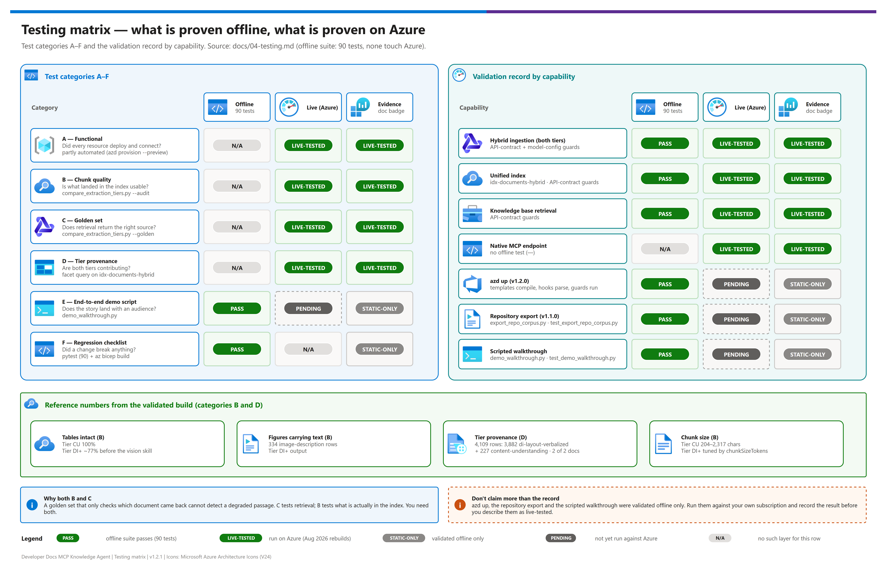
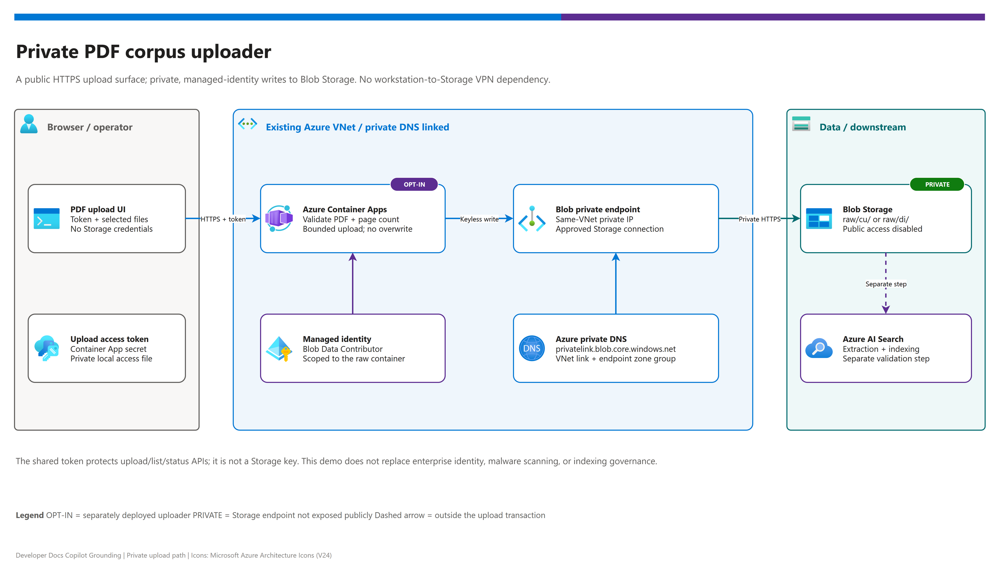

[README](../README.md) › [docs index](./00-reproduce-this-demo.md) › 04 Testing

# 04 — Testing

<p>
&nbsp;
&nbsp;
&nbsp;
&nbsp;
&nbsp;

</p>

   

How to prove the build actually works — and, specifically, that **both ingestion tiers are
earning their place**. Run these after [03-deployment.md](./03-deployment.md). This page is also the honest record of what has and has not been run against Azure: see [Live validation](#live-validation).

> [!IMPORTANT]
> **The trap this test plan exists to avoid.** The first build of this pattern passed a 4/4
> golden set and was declared working. Auditing the *content* of the index afterwards found
> 27% of tables split mid-table, 36% of figures discarded as empty tags, and 41% of heading
> citations pointing at the wrong section. **A golden set that only checks which document came
> back cannot detect a degraded passage.** Category C tests retrieval; category B tests what
> is actually in the index. You need both.

## At a glance

| | Topic | One-line answer |
|---|---|---|
|  | **What proves it works** | Chunk-quality audit (B) *and* golden set (C) — not retrieval alone |
|  | **Most valuable test** | The figure-only golden question — fails silently without the vision path |
|  | **Offline suite** | `python -m pytest tests -q` — 90 tests, none touch Azure |
|  | **Live evidence** | Two clean-room teardown/rebuilds in Aug 2026 ([docs/09](./09-findings-and-lessons.md)) |

[](./assets/testing-matrix.png)

<sub>Editable source: [`assets/testing-matrix.drawio`](./assets/testing-matrix.drawio) - regenerate with `python scripts/export_diagrams.py docs/assets`.</sub>

---

## Test categories

| | # | Category | Answers | Automated | Evidence |
|---|---|---|---|---|---|
|  | A | Functional | Did every resource deploy and connect? | partly (`azd provision --preview` for a dry run) |  |
|  | B | **Chunk quality** | Is what landed in the index actually usable? | ✅ `compare_extraction_tiers.py --audit` |  |
|  | C | Quality (golden set) | Does retrieval return the right source? | ✅ `compare_extraction_tiers.py --golden` |  |
|  | D | **Tier provenance** | Are both tiers contributing? | ✅ facet query |  |
|  | E | End-to-end demo script | Does the story land with an audience? | ✅ `demo_walkthrough.py` |  |
|  | F | Regression checklist | Did a change break anything? | ✅ `pytest` |  |

> [!NOTE]
> The badges describe how each *layer's tooling* has been validated, not how often you should run it: categories A-D were exercised against Azure in the Aug 2026 rebuilds, while the walkthrough script (E) and the offline regression suite (F) have only been run offline. See [Live validation](#live-validation).

---

## A — Functional tests

| Check | How | Pass |
|---|---|---|
| Resources deployed | `az resource list -g <rg> -o table` | Storage, Foundry (+ project), Search, Key Vault all present |
| Model deployments | `az cognitiveservices account deployment list -n <foundry> -g <rg> -o table` | Configured `embedding`, `chat`, `vision`; `frontier` only if explicitly selected |
| Corpus routed | `python hybrid_ingest.py --ids-file ../demo-ids.local.json --plan --source-dir <dir>` | Each document shows a tier and a reason |
| Blobs uploaded | Portal or `az storage blob list` | Files under `raw/cu/` and/or `raw/di/` |
| Both indexers ran | `python hybrid_ingest.py --ids-file ../demo-ids.local.json --status` | Both `success`, 0 failed |
| MCP endpoint | `python post_deploy_search.py --ids-file ../demo-ids.local.json --check-mcp-endpoint` | `Native MCP endpoint AVAILABLE.` |

---

### Enhancement checks (not a new live-validation claim)

- Run [frontend offline checks](../frontend/README.md#validate-without-cloud-access), then
  exercise local/container retrieval with your own existing Azure configuration.
- Inspect diagram-only questions: preserve source/page metadata, show uncertainty for
  unreadable labels, and do not accept inferred connectivity as verified electrical behavior.
- Run the existing DI/CU harness on shared source coverage; compare provenance rather than
  assuming CU-only is always better. An all-DI+ run remains supported.
- Test the answer deployment separately from the vision deployment and Search planner.
  Provisioning success or a frontend configuration indicator does not prove serving readiness.

## B — Chunk-quality audit (do not skip)

```bash
cd scripts
python compare_extraction_tiers.py --ids-file ../demo-ids.local.json --audit
```

Reports per tier: table integrity, figure handling, citation validity, and chunk-size
distribution. Reference numbers from the validated build:

| Metric | Tier CU | Tier DI+ | Why it matters |
|---|---|---|---|
| Tables intact | **100%** | ~77% before the vision skill | A split table loses its header row — the surviving cells lose all meaning |
| Figures carrying text | native descriptions | **334 image-description rows** | An empty `<figure></figure>` means a diagram was detected and thrown away |
| Citation validity | page range — structurally cannot misattribute | deepest heading only, never a path | A confidently wrong citation is worse than a coarse one |
| Chunk size | 204–2,317 chars | tuned by `chunkSizeTokens` | Sub-300-char chunks are retrieval noise; 6,000+ char chunks bury the answer |

> [!WARNING]
> **Fail conditions:** any chunk under ~100 characters in bulk, empty `<figure></figure>` tags
> in Tier DI+ output (means the vision skill did not run), or `sectionLabel`/`pageNumber*` empty
> across the board.

---

## C — Quality (golden set)

Build 5–10 questions from your own corpus in a local JSON file. Each `expect`
must exactly match a `sourceDocument` value indexed by **both** tiers:

```json
[
  {"q": "Which component connects to the labeled port?", "expect": "manual.pdf"},
  {"q": "What capacity does the technical guide specify?", "expect": "technical-guide.pdf"}
]
```

From `scripts/`, run the comparison with that file:

```bash
python compare_extraction_tiers.py --ids-file ../demo-ids.local.json --golden --golden-file <path-to-questions.json>
```

The built-in questions used when `--golden-file` is omitted are specific to the
historical RISC-V corpus. The comparison skips sources not present in both
indexes and stops if no questions are comparable. Its score checks the **top
source only**, not the answer, page, or diagram interpretation; verify those
against the original PDF separately. Keep corpus-specific questions and
evaluation results private when the documents are not shareable.

Include at least one question of each kind:

| Kind | Example | Proves |
|---|---|---|
| Prose lookup | *"What does the dmcontrol register control?"* | Basic retrieval |
| Cross-document | a question answerable from only one of several documents | Correct routing, no bleed |
| **Figure-only** | *"What is the bit width of the mtime register and which bits does it span?"* | Locates the source; manually verify the figure-derived answer |
| Deep-section | something under a 4th- or 5th-level heading | Locates the source; manually verify citation granularity |
| Out-of-corpus | something the corpus genuinely does not cover | Test separately for honest abstention; the source-only golden format cannot express it |

> [!TIP]
> **The figure-only question is especially valuable.** Verify its answer and cited page;
> returning the right document alone does not prove the diagram was understood.

---

## D — Tier provenance (is the hybrid actually hybrid?)

A single unified index makes it easy to *assume* both tiers contributed. Verify it.

**Any platform** — `curl` ships with Windows 10+, Linux and macOS:

```bash
AK=$(az search admin-key show -g <rg> --service-name <search> --query primaryKey -o tsv)
curl -s -X POST "https://<search>.search.windows.net/indexes/idx-documents-hybrid/docs/search?api-version=2026-05-01-preview" -H "api-key: $AK" -H "Content-Type: application/json" -d '{"search":"*","top":0,"count":true,"facets":["extractionTier","contentKind","sourceDocument,count:50"]}'
```

<details>
<summary>PowerShell equivalent (nicer output formatting)</summary>

```powershell
$ak = az search admin-key show -g <rg> --service-name <search> --query primaryKey -o tsv
$body = @{ search='*'; top=0; count=$true; facets=@('extractionTier','contentKind','sourceDocument,count:50') } | ConvertTo-Json
Invoke-RestMethod -Uri "https://<search>.search.windows.net/indexes/idx-documents-hybrid/docs/search?api-version=2026-05-01-preview" -Method Post -Headers @{'api-key'=$ak;'Content-Type'='application/json'} -Body $body | Select-Object -ExpandProperty '@search.facets'
```

</details>

| Check | Pass |
|---|---|
| `extractionTier` facet | One entry per tier you routed to — a missing tier means that indexer silently produced nothing |
| `contentKind` facet | `image-description` rows present if any routed document has figures |
| `sourceDocument` facet | **Every** document from `--plan` appears — a missing document is a rejected ingest, not a rounding error |

Reference build: 4,109 rows — 3,882 `di-layout-verbalized`, 227 `content-understanding`, of
which 334 `image-description`, across 2 of 2 documents.

Then confirm a single query draws on **both** tiers:

```bash
python compare_extraction_tiers.py --ids-file ../demo-ids.local.json --report
```

---

## E — End-to-end demo script

Scripted and self-checking — see [11-demo-walkthrough.md](./11-demo-walkthrough.md):

```bash
python demo_walkthrough.py --ids-file ../demo-ids.local.json --script ../samples/walkthrough.example.json --report
```

The steps it runs, and what to say at each:

1. Show `--plan` — the routing decision, with the page-count reason per document. *"We don't
   pick a service; we route per document, and the decision is free."*
2. In VS Code agent mode, ask a prose question → grounded answer with a citation.
3. Ask the **figure-only** question → the answer comes from a diagram the baseline pipeline
   would have discarded. *This is the step that proves the whole pattern works.*
4. Show the `extractionTier` facet → both services contributed to one seamless corpus.
5. Ask an out-of-corpus question → honest "no relevant content", not a hallucination.
6. *(Optional)* Open the repository export ([docs/10](./10-repo-corpus-export.md)) → the same
   section as a page-cited Markdown file with the original figure and the register's bit-field
   diagram, committed next to the code.

---

## F — Regression checklist

Install the pinned requirements first. `tests/test_mcp_fallback_server.py` imports the `mcp`
SDK, and without it pytest reports a **collection error** for that file, not a test failure:

```bash
pip install -r scripts/requirements.txt
python -m pytest tests -q          # 90 tests, all offline
az bicep build --file infra/main.bicep --stdout > $null
az bicep build --file infra/azd.bicep --stdout > $null    # azd entry point
python scripts/export_diagrams.py docs/assets --check   # every diagram PNG is newer than its .drawio
```

| Test file | Covers |
|---|---|
| `test_post_deploy_search.py` | API-contract guards, reusability guards, model configuration |
| `test_compare_extraction_tiers.py` | Harness methodology guards |
| `test_mcp_fallback_server.py` | Optional MCP wrapper |
| `test_export_repo_corpus.py` | Section splitting, page mapping across split parts, figure rewriting, register/pin/electrical extraction, manifest |
| `test_demo_walkthrough.py` | Walkthrough pass/fail rules, both response shapes, and the oversized-upload guard |
| `test_configuration.py` | azd ↔ Bicep parameter wiring, quoted parameter substitutions, hook ↔ output contract, and that **every** azd variable, output and script setting is documented in docs/12 |
| `uploader/tests/test_app.py` | Upload authentication, bounded streaming, PDF validation, page routing, explicit oversized-file consent, private DNS, integrity receipts, and no overwrite |

For the optional uploader, run `python -m pytest uploader/tests tests/test_configuration.py -q`
(32 focused tests passed on 2026-11-03), parse the deployment/upload PowerShell
scripts, and compile `infra/uploader.bicep`. Its [runbook](../uploader/README.md)
includes the separate live readiness and hash-verifying upload commands.

Run after any change to `scripts/`, `infra/`, or the index schema. The suite includes one
regression test per defect class found during live builds — API-contract guards, harness
methodology guards, and model-configuration guards.

---

## When to re-run what

| Trigger | Re-run |
|---|---|
| Changed a skillset or index schema | B, C, D, F |
| Added or changed corpus documents | A (routing), B, C, D |
| Changed a model deployment | B (figure quality), C, F |
| Upgraded the Search API version | A, D, F |
| Before any live demo | E, plus a smoke pass of A |

---

## Live validation

> [!NOTE]
> **2026-11-16 Foundry IQ migration:** the new agent request path, session-bound
> follow-ups, citations and readiness checks have offline tests and the live smoke
> evidence below. Scored corpus quality is still unproven; use the
> [Q&A acceptance checks](./13-foundry-iq-qa.md#acceptance-checks-and-remaining-boundaries)
> before claiming quality acceptance.

What has actually been run, and where. Nothing on this page claims more than the record in [09 — Findings and lessons](./09-findings-and-lessons.md).

| Capability | Offline checks | Live (against Azure) | Evidence |
|---|---|---|---|
| Hybrid ingestion (both tiers) | ✅ API-contract and model-configuration guards | ✅ Two clean-room teardown/rebuilds, Aug 2026 |  |
| Unified index (`idx-documents-hybrid`) | ✅ API-contract guards | ✅ Same rebuilds |  |
| Knowledge base retrieval | ✅ API-contract guards | ✅ Same rebuilds |  |
| Native MCP endpoint | — | ✅ Same rebuilds |  |
| `azd up` (v1.2.0) | ✅ Templates compile, hooks parse, guards exercised locally | ⚠️ Foundation/models deployed; the complete postprovision flow has not finished |  |
| Optional PDF uploader | ✅ 21 API tests; configuration guards and template/syntax checks | ✅ VNet-connected app, private Storage, three hash-verified PDFs, 401/409 checks |  |
| Repository export (`export_repo_corpus.py`, v1.1.0) | ✅ `test_export_repo_corpus.py` | ⏳ Not run against Azure |  |
| Scripted walkthrough (`demo_walkthrough.py`) | ✅ `test_demo_walkthrough.py` | ⏳ Not run against Azure |  |

### 2026-11-16 — Foundry IQ Q&A

| Check | Result | Evidence / boundary |
|---|---|---|
| Existing index readiness | Passed | Both hybrid CU and DI indexers had successful runs with zero failed documents; source index was non-empty |
| Search managed-identity authentication | Corrected and read back | Existing service was `apiKeyOnly`; a reader role alone led to `tool_user_error`. Enabled `aadOrApiKey` and retained key-based clients |
| Project connection and agent | Configured and read back | Project identity has Search Index Data Reader; RemoteTool connection uses native KB MCP; agent v1 allows only `knowledge_base_retrieve`, with approval disabled for that tool |
| Setup smoke query | Completed | Corpus inventory returned three structured URL citations |
| Live gateway question | Completed | R730xd drive-bay question returned an answer with six citations |
| Live gateway follow-up | Completed | Asked which of those configurations use 3.5-inch drives, sending the prior response ID; answer returned five citations |
| Browser-session isolation | Passed | A second session attempting to reuse the response ID received HTTP 409 |
| Edge UI regression | Passed with mocked API | Answer-first selection, source link rendering, follow-up payload, reset, passive HTML/table rendering; no live-browser UI claim |
| Source access / quality | Not accepted | Structured links target authenticated Search documents; private PDF access, exact fact/page accuracy and diagram fidelity were not independently scored |
| Full fresh `azd up` | Not rerun | Existing foundation and ingestion reused; no claim that the full new-subscription flow was exercised |

The failure and fix follow [Search's documented dual-authentication configuration](https://learn.microsoft.com/en-us/azure/search/search-security-enable-roles).
See the [Foundry IQ runbook](./13-foundry-iq-qa.md) for reproduction.

### 2026-11-03 — Central US Dell PDF deployment

| Validation stage | Result | Evidence |
|---|---|---|
| Infrastructure and Foundry project | ✅ Deployed | Existing Storage, Search, Key Vault, and Foundry resources were retained; the Foundry project was created. |
| Model deployments | ✅ Deployed | `text-embedding-3-large`, `gpt-5-mini`, and `gpt-4.1` report `Succeeded`. |
| Blob private endpoint and Azure private DNS | ✅ Provisioned | The endpoint connection is approved in an existing VNet with a connected site-to-site VPN. The private DNS zone, VNet link, and endpoint zone group succeeded; Storage public access remains disabled. |
| Workstation direct private access | ⚠️ Bypassed | Private DNS and TCP worked, but HTTPS/TLS reset. The uploader removes this workstation-to-Storage dependency without changing VPN/firewall rules. |
| Uploader Container App | ✅ Running | South Central US workload-profile environment, dedicated delegated subnet, nonroot image built in ACR, user-assigned identity, 0–1 replicas. |
| Uploader authentication | ✅ Verified | UI/health return 200; upload, listing, and status APIs reject anonymous requests with 401. |
| Private Storage connection | ✅ Verified | Authenticated app status resolves the Blob hostname to the private endpoint and reads container properties. Public Storage access remains disabled; the identity's Blob Data Contributor role is scoped to `raw`. |
| Dell PDF upload | ✅ Verified | Three PDFs, 284 pages, 14,811,662 bytes per tier; byte-identical copies are under both `cu/` and `di/` for a matched corpus. SHA-256 and length match every local source. Largest file: 12,151,942 bytes. Duplicate upload returns 409. |
| Hybrid Search build | ✅ Completed | Corrected the identity connector to the required `ResourceId=<storage-resource-id>/;` form. Deployed a dedicated South Central US Foundry resource/project because Central US does not support the CU  API, and granted the Search identity `Cognitive Services User`. CU and DI+ each indexed all three matching PDFs with 0 failures. |
| Hybrid Knowledge Base retrieval | ✅ Smoke-tested | A Dell drive-bay question returned grounded passages from the datasheet and technical guide with source pages. This is a retrieval smoke test, not a scored quality comparison. |
| Native hybrid MCP endpoint | ✅ Smoke-tested | `initialize`, `tools/list`, and a live `knowledge_base_retrieve` call succeeded on the Dell corpus. |
| Per-tier search comparison | ✅ Smoke-tested | The same query returned separate CU and DI+ passages for two shared sources. This is not a scored quality comparison. |
| Local Q&A frontend | ✅ Smoke-tested | The localhost gateway used the hybrid Knowledge Base through its stdio MCP wrapper and the Entra-only chat deployment. API retrieval and grounded answers returned citations; a browser submission rendered an answer and source cards. The direct PDF link points to private Storage and did not connect from this workstation. |
| Scored DI/CU and diagram comparison | ⏳ Not run | Both tiers finished indexing, but extraction quality and diagram fidelity have not been scored against the shared corpus. |

| Uploaded example PDF | Pages | Bytes | Integrity |
|---|---|---|---|
| `Dell-PowerEdge-R730-and-R730xd-Technical-Guide-v1-7.pdf` | 66 | 2,364,739 | SHA-256 + length match |
| `dell-poweredge-r730xd-datasheet.pdf` | 2 | 294,981 | SHA-256 + length match |
| `r730xd-ompublication-en-us.pdf` | 216 | 12,151,942 | SHA-256 + length match |

[](./assets/private-pdf-uploader.png)

<sub>Editable source: [private-pdf-uploader.drawio](./assets/private-pdf-uploader.drawio).</sub>

> [!CAUTION]
> Infrastructure, PDF uploads, both indexers, Knowledge Base and native MCP
> retrieval, and the local Q&A frontend have been smoke-tested. The per-tier
> query comparison is not a quality score; diagram fidelity, the scored DI/CU
> comparison, repository export, and scripted walkthrough remain unvalidated
> against this corpus. Direct PDF links still require working private Storage
> connectivity and authorization; use the local source copies to verify answers.

---

Next: [05 - Troubleshooting](./05-troubleshooting.md) →

*Last updated: 2026-11-16*
