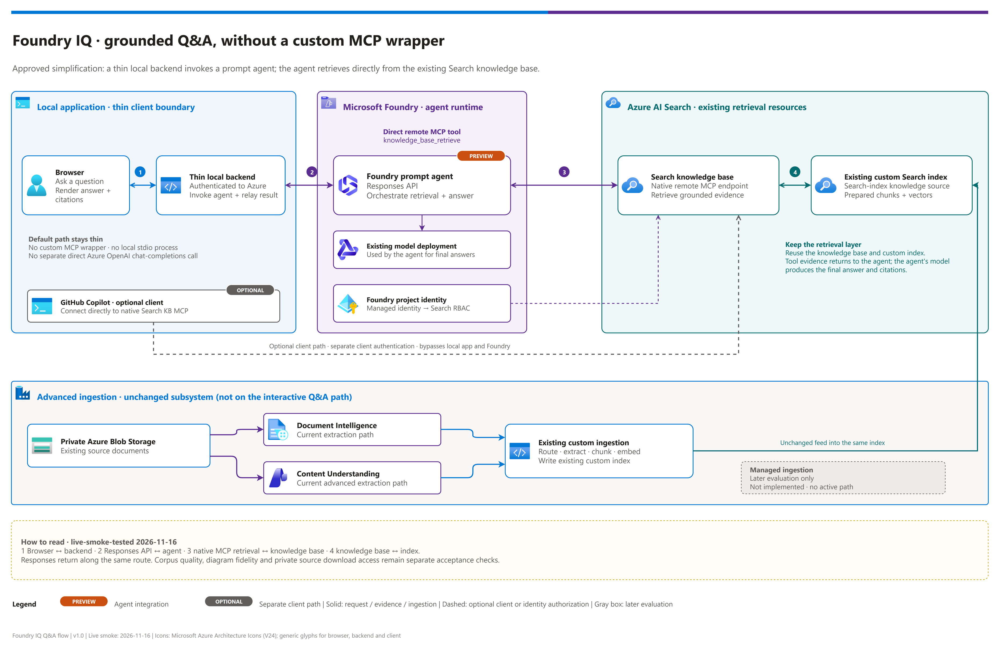

[README](../README.md) > Foundry IQ Q&A

# 13 - Simpler document Q&A with Foundry IQ

<p>


</p>

 

This runbook is for someone who already has this demo's indexed PDF corpus and
wants an answer-first browser experience without operating another MCP server.
A Microsoft Foundry prompt agent calls the existing Search knowledge base
directly through its native MCP tool. The current ingestion pipeline stays in
place so changing the chat application does not silently change extraction quality.

## At a glance

| Component | Responsibility | Recommendation |
|---|---|---|
|  Browser + small local gateway | Display answers, returned citations and follow-up turns | Default Q&A client; credentials remain server-side |
|  Foundry prompt agent | Invoke retrieval and generate the final answer | Reuse an existing compatible model deployment |
|  Foundry IQ knowledge base | Retrieve evidence over the existing index | Keep `extractiveData`; do not synthesize a second final answer here |
|  Existing DI/CU ingestion | Extract, chunk and index the PDFs | Retain until a managed-ingestion comparison passes |
|  Native MCP Copilot client | Ground the coding assistant directly | Still supported; it does not need the browser |
|  Custom MCP wrapper | Diagnostic evidence inspection and legacy clients | Not part of default browser Q&A |

> [!IMPORTANT]
> The Foundry agent integration uses preview connection/MCP APIs. Setup, cited
> answers and a live follow-up passed on 2026-11-16; this is a smoke test, not a
> scored corpus-quality or source-download-access evaluation. See
> [04 - Testing](./04-testing.md#2026-11-16--foundry-iq-qa).

## Request path

[](./assets/foundry-iq-qa-flow.png)

<sub>Editable source: [foundry-iq-qa-flow.drawio](./assets/foundry-iq-qa-flow.drawio).</sub>

The browser sends the question to the gateway. The gateway calls the project's
Responses endpoint with an `agent_reference`; it does not retrieve passages or
call Azure OpenAI directly. The agent calls only `knowledge_base_retrieve` on the
allowlisted knowledge-base connection, then writes the answer. Follow-ups include
the preceding response ID. An HttpOnly, same-site browser cookie binds that ID to
the local browser session; IDs from another browser session are rejected.

The browser displays the latest answer first. Earlier question/answer turns are
available in a collapsed history section. **New conversation** stops sending the
prior response ID; it does not delete already stored Foundry responses. The UI
does not persist history to browser storage. Responses appear when completed;
token streaming is not implemented.

Structured URL annotations become source cards. Reference text in the answer is
preserved even if the agent returns no structured URLs. The UI never manufactures
a page, URL or citation from a document title. Search-index sources can return
knowledge-base links instead of original document links; do not treat these as
page-level document access.

Sources: [Connect Foundry IQ to agents](https://learn.microsoft.com/en-us/azure/foundry/agents/how-to/foundry-iq-connect)
and [Foundry agent runtime components](https://learn.microsoft.com/en-us/azure/foundry/agents/concepts/runtime-components).

## Prerequisites and authentication

| Prerequisite | Check before setup |
|---|---|
| Existing Foundry project | A resource-backed project, not a hub-based project; system-assigned project identity enabled |
| Existing knowledge base | At least one `searchIndex` knowledge source and a non-empty index |
| Ingestion | Every selected indexer has a successful last run with zero failed documents |
| Answer deployment | `foundryAgentModel`, or the existing `chatDeployment`, is available and compatible with the agent |
| Setup permissions | Project/connection management plus permission to assign Search RBAC to the project identity |
| Runtime permissions | Caller can invoke the Foundry agent; project identity can read Search |
| Python | Python 3.11+ with `scripts/requirements.txt` and `frontend/requirements.txt` installed in an isolated environment |

The setup helper assigns **Search Index Data Reader** to the project identity on
the existing Search service. It enables **dual API-key/Entra authentication**
when the service was key-only, preserving existing key-based ingestion and
diagnostic clients. A reader role alone does not enable Entra authentication.
Search's existing identity/model access remains
necessary when the knowledge base performs model-backed query planning.
No new vision model, Container App, registry or uploader is created for Q&A.

Source: [Enable role-based access on Search](https://learn.microsoft.com/en-us/azure/search/search-security-enable-roles).

<details>
<summary>Authenticate both CLIs to the explicit deployment target</summary>

```powershell
az account show --query "{tenant:tenantId,subscription:id,user:user.name}" -o table
# If different from demo-ids.local.json:
az login --tenant <demo-tenant-id>
az account set --subscription <demo-subscription-id>
az account show --query "{tenant:tenantId,subscription:id}" -o table

# Needed only when provisioning infrastructure through azd:
azd auth login --tenant-id <demo-tenant-id>
azd env set AZURE_TENANT_ID <demo-tenant-id>
azd env set AZURE_SUBSCRIPTION_ID <demo-subscription-id>
```

</details>

> [!NOTE]
> The local gateway verifies tenant and subscription before each token acquisition.
> Agent requests use `https://ai.azure.com/`, not the Cognitive Services model
> audience. Container deployments can select `FOUNDRY_AUTH_MODE=managed-identity`;
> grant that identity permission to invoke the agent. This does not add end-user
> authentication to the browser application.

## Configure an existing corpus

| Step | Action | Checkpoint |
|---|---|---|
| 1 | Verify the intended demo tenant/subscription | `az account show` matches local IDs |
| 2 | Install the two requirements files in your isolated Python environment | SDK imports and offline tests pass |
| 3 | Run the helper below | Index readiness, connection setup and agent invocation succeed |
| 4 | Open the agent in the Foundry playground | A corpus question returns an evidence-backed answer |
| 5 | Launch the local browser | Answer, references and a follow-up are visible |

```powershell
python -m pip install -r scripts\requirements.txt -r frontend\requirements.txt
python scripts\configure_foundry_iq.py --ids-file demo-ids.local.json --knowledge-base kb-hybrid
.\scripts\start_qa.ps1 -IdsFile .\demo-ids.local.json -Python <path-to-environment-python.exe>
```

Open `http://127.0.0.1:8000`. Keep the gateway on loopback.
The helper reuses the knowledge base and index. It changes the knowledge base to
extractive output while preserving its existing retrieval-model configuration,
creates/updates a project-managed-identity remote-tool connection, and creates a
prompt-agent version through the SDK. It saves the agent name, version and a
definition fingerprint in the gitignored IDs file. Repeating an unchanged setup
reuses the saved version; `--force` deliberately creates another version. Agent
invocation uses the documented name-based agent reference.

The helper performs a completed-answer smoke check, **not** a scored evaluation
or a guarantee that every answer has structured URL annotations.
If the agent was deleted outside this setup, rerun with `--force`.

Additional setup switches:

| Switch | Default | Effect |
|---|---|---|
| `--knowledge-base` | `foundryKnowledgeBaseName`, otherwise `kb-hybrid` | Existing KB to connect; set explicitly for a baseline build |
| `--indexer` | Discover indexers targeting the KB's source indices | Repeat to select only active ingestion tiers |
| `--timeout` | 3600 seconds | Maximum index-readiness wait |
| `--smoke-query` | Request a source-cited corpus inventory | Use a known-answer corpus question for a more useful smoke check |
| `--check` | false | Verify readiness and invoke the existing agent without configuring resources |
| `--force` | false | Create a new agent version even when the saved definition matches |

## New deployment and manual path

| Entry point | What changes | Recommendation |
|---|---|---|
| `azd up` | Postprovision now runs the same agent setup after optional ingestion | Set a real `DEMO_CORPUS_DIR`, or reuse an already indexed KB |
| `azd env set DEMO_CONFIGURE_FOUNDRY false` | Foundation-only provisioning; no ready-Q&A claim | Use only when deliberately separating infrastructure and data setup |
| Existing/manual foundation | Run the same setup command after ingestion | No IaC redeployment or model reprovisioning needed |
| Foundry portal | Build > Knowledge, connect the KB to a prompt agent, test in Agents playground | Useful for understanding the connection before automating it |

`FOUNDRY_KNOWLEDGE_BASE` chooses a non-default KB in postprovision. A missing
`DEMO_CORPUS_DIR` now fails rather than silently skipping ingestion. Agent setup
waits for successful ingestion and rejects an empty index; a provisioned resource
group alone is no longer reported as a ready-to-query application.

For a no-IaC setup, enable the project identity in Foundry, grant it Search Index
Data Reader on Search, add the knowledge-base connection, and create the agent
in the portal as described in Microsoft's connection guide. If you choose a
different agent/connection name, populate the corresponding local IDs fields
before starting the browser. The portal playground is a proof surface, not a
standalone end-user website.

## Configuration and retained diagnostic path

| Configuration | Purpose |
|---|---|
| `FOUNDRY_PROJECT_ENDPOINT`, `FOUNDRY_AGENT_NAME` | Server-selected project and agent |
| `FOUNDRY_AUTH_MODE` | `azure-cli` locally; `managed-identity` for an explicitly configured Azure host |
| `FOUNDRY_TENANT_ID`, `FOUNDRY_SUBSCRIPTION_ID` | Required local context guard |
| `QA_BACKEND=foundry` | Default browser Q&A |
| `QA_BACKEND=legacy` | Explicit opt-in to the previous wrapper + direct model path |

The launcher reads only non-secret identity/agent fields from the IDs file and
sets the process environment. The default Foundry path does not need
`SEARCH_API_KEY`, an MCP bearer token or `AZURE_OPENAI_API_KEY`.
**Inspect retrieval (diagnostic)** still needs the legacy wrapper's separate
Search configuration. A Foundry error is shown as an error; it never silently
switches retrieval or answer models. See the [complete configuration reference](./12-configuration-reference.md).

## Acceptance checks and remaining boundaries

The 2026-11-16 live run passed setup/inventory (three structured citations), an
R730xd drive-bay question (six citations), its 3.5-inch-drive follow-up (five
citations), and cross-session response-ID rejection (HTTP 409). Cloud read-back
confirmed dual Search authentication and the agent's single-tool allowlist.
The source cards linked to authenticated Search documents rather than public
PDF downloads. The acceptance matrix below remains the broader quality target.

| Check | Expected result |
|---|---|
| Known document fact | Correct answer with references supported by the corpus |
| Follow-up | Uses prior-turn context and retrieves again |
| New conversation | Does not send the previous response ID |
| Missing evidence | Explicit uncertainty, not a plausible invented answer |
| Table question | Values and headers remain interpretable |
| Figure/page question | Compare against the original cited PDF; missing page metadata stays missing |
| Private source link | Access is tested separately; IQ does not bypass Storage authorization |
| Wrong CLI tenant/subscription | Request fails before token acquisition |
| Failed indexing or empty corpus | Setup cannot report ready |
| Agent/model/tool failure | Visible error; no legacy fallback |

> [!TIP]
> Evaluate a [managed Blob knowledge source](https://learn.microsoft.com/en-us/azure/search/agentic-knowledge-source-how-to-blob)
> later using the same corpus and questions. A small demo could also evaluate the
> preview [file knowledge source](https://learn.microsoft.com/en-us/azure/search/agentic-knowledge-source-how-to-file).
> Neither option is enabled here. Preserve the current DI/CU pipeline until tables,
> figures, citations and access requirements pass the comparison.

Offline checks:

```powershell
python -m pytest frontend\tests tests\test_foundry_iq.py tests\test_configuration.py -q
node --check frontend\static\app.js
```

The local session register is intentionally in-memory and bounded. Restarting the
gateway invalidates its follow-up bindings; start a new conversation after a
restart. Multi-worker or public deployments need shared session state, user
authentication, authorization, TLS and request controls. Private networking to
Search/Storage and downloadable source access are separate deployment concerns.

---

Next: [04 - Testing](./04-testing.md) >

*Last updated: 2026-11-16*
