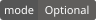
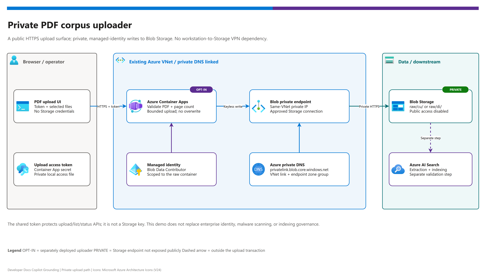

[README](../README.md) > PDF uploader

# Private-storage PDF uploader

<p>
&nbsp;
&nbsp;
&nbsp;

</p>

 

A small browser application for operators who can reach Container Apps over HTTPS but
cannot upload directly to a private Storage account. The application validates each PDF
and writes it through a Blob private endpoint using managed identity. It is independent
of the Q&A frontend and does not change the existing DI/CU comparison pipeline.

[](../docs/assets/private-pdf-uploader.png)

<sub>Editable source: [private-pdf-uploader.drawio](../docs/assets/private-pdf-uploader.drawio).</sub>

## At a glance

| | Component | Responsibility |
|---|---|---|
|  | Browser | Upload token, file selection, upload progress, explicit success/error per file |
|  | Container App | PDF validation, page counting, size enforcement, SHA-256, tier routing |
|  | Managed identity | `AcrPull` on the registry and `Storage Blob Data Contributor` on only the raw container |
|  | Existing VNet + private endpoint | Private outbound Storage connection; public Storage access stays disabled |
|  | Existing indexers | Extraction and indexing after upload; **not** performed by this app |

> [!IMPORTANT]
> This is a shared-token demonstration, not enterprise user authentication. The UI and
> health endpoint are public; every upload, document listing, and Storage status request
> requires the token in an Authorization header. The app does not save it in browser
> storage or put it in URLs. Use Entra authentication, authorization, malware scanning,
> and appropriate upload/retention policies before production use.

## Upload contract

| Condition | Result | Recommendation |
|---|---|---|
| Valid PDF, up to 300 pages, CU enabled | `raw/cu/<filename>` | Normal Content Understanding path |
| Valid PDF over 300 pages | Rejected until explicit unsplit consent | Split locally first; only choose DI+ deliberately |
| Explicit unsplit consent, or CU disabled in deployment | `raw/di/<filename>` | Existing DI+ extraction path |
| Existing destination blob | HTTP 409, no overwrite | Inspect the stored document; no delete/replace API is exposed |
| Invalid/encrypted PDF or unsafe basename | HTTP 400, no write | Fix the document or name |
| File above configured size (default 32 MiB) | HTTP 413, no write | Reduce size or explicitly raise the deployment limit |
| Another upload in progress | HTTP 429 | Upload sequentially |
| Private DNS, identity, or Storage failure | HTTP 503 | Inspect Container App logs; never treat it as uploaded |

The server streams into a bounded temporary file, validates the PDF, then writes it
atomically as a non-overwriting block blob. The response includes bytes, page count,
destination, ETag, and SHA-256. A successful response proves upload, **not** extraction,
diagram interpretation, indexing, or retrieval readiness.

## Deploy after the foundation

The helper uses [`infra/uploader.bicep`](../infra/uploader.bicep) twice: provision
registry/identity/environment first, build the image remotely using
[`az acr build`](https://learn.microsoft.com/azure/container-registry/container-registry-tasks-overview),
then deploy the real app. No local Docker installation is required; only the allowlisted
`uploader/` build context is sent, not your PDFs or local credentials.

1. Authenticate explicitly and verify the target:

   ```powershell
   az login --tenant <tenant-id>
   az account set --subscription <subscription-id>
   az account show --query "{tenant:tenantId,subscription:id}" -o table
   ```

2. Provide an existing **dedicated /27-or-larger subnet**, delegated to
   `Microsoft.App/environments`, in the VNet linked to your private Blob DNS zone.
   The environment is deployed in the VNet region, even if Storage is elsewhere.
   See [Container Apps custom VNet setup](https://learn.microsoft.com/azure/container-apps/vnet-custom-internal)
   and [networking](https://learn.microsoft.com/azure/container-apps/networking).
   Do not reuse the private endpoint, gateway, Bastion, or another service's subnet.

3. From the repository root:

   ```powershell
   .\scripts\deploy_uploader.ps1 `
     -IdsFile .\demo-ids.local.json `
     -SubnetId <dedicated-subnet-resource-id>
   ```

   Optional parameters: `-AccessFile <private-local-json-path>`,
   `-MaxUploadBytes 33554432`, and `-ImageTag pdf-uploader:<existing-tag>` to reuse a
   verified image in this deployment's registry. The default access file is under the current user's
   local application data directory, `DeveloperDocsUploader/<environment>.local.json`.
   It contains the upload token and URL; keep it private and out of source control.
   The token is also stored as the Container App `upload-token` secret. Redeployments
   reuse the access file, so an ordinary image rebuild does not rotate the token.

   Build output is not streamed, avoiding Windows console encoding failures in pip
   progress logs. The command still waits for build completion and fails on a failed
   build. Inspect ACR Tasks run history for detailed logs.

4. Open the returned URL, paste the token, choose **Check private Storage**, and upload
   your PDFs. Do not copy the token into chat, screenshots, logs, or deployment IDs.
   The deployment adds a non-secret `uploader` object to `demo-ids.local.json`.

> [!NOTE]
> The deployment creates a Basic registry, a Consumption workload-profile environment,
> a managed identity, container-scoped RBAC, an application, and a Log Analytics workspace.
> The app scales from zero to one replica with 0.5 vCPU / 1 GiB. Registry, logs, private
> networking, and any active replicas still have their own charges; scale-to-zero does
> not make the entire deployment free.

### Optional azd integration

After authenticating **both** az and azd to the same tenant and setting
`AZURE_TENANT_ID` / `AZURE_SUBSCRIPTION_ID` as in [03 Deployment](../docs/03-deployment.md):

```powershell
azd env set DEMO_DEPLOY_UPLOADER true
azd env set UPLOADER_SUBNET_ID <dedicated-subnet-resource-id>
azd provision --preview
azd up
```

The postprovision hook calls the same deployment helper and Bicep template. If
`DEMO_CORPUS_DIR` is set, PDFs are sent through the uploader before the existing index
build. This upload path **does not automatically split PDFs**: pre-split oversized
documents yourself, or set `DEMO_SPLIT=false` to explicitly allow unsplit DI+ routing.
Do not enable this option if the foundation has no Blob private endpoint and linked
private DNS in the selected VNet.

## Content Understanding region requirement

The hybrid Content Understanding Search skill calls the Foundry Content Understanding
API. Microsoft lists South Central US as supported but not Central US; the Azure AI
Search service may remain in Central US. If CU indexing reports that the GA API is
not supported in the Foundry resource region, deploy the separate supported-region
Foundry resource and grant Search access:

```powershell
# From the repository root:
.\scripts\deploy_content_understanding.ps1 -IdsFile .\demo-ids.local.json
```

The template creates an S0 `AIServices` account/project in South Central US and grants
the Search managed identity `Cognitive Services User`. It creates no model deployment.
The CU skillsets use its `contentUnderstandingSubdomainUrl`; Document Intelligence,
the existing vision/chat models, and embeddings continue using the foundation account.
This additional service is consumption-billed when used. The regional list is in
[Microsoft Learn — Content Understanding region and language support](https://learn.microsoft.com/azure/ai-services/content-understanding/language-region-support);
the [Search skill documentation](https://learn.microsoft.com/azure/search/cognitive-search-skill-content-understanding)
states that the Foundry resource must be in a supported region while Search can be in
any supported Search region.

## Validate and operate

Live validation on 2026-11-03 uploaded three Dell hardware PDFs (284 pages,
14,811,662 bytes), including a 12,151,942-byte manual. Every returned hash/length
matched its source; duplicate upload returned 409, unauthenticated API requests
returned 401, and the app reached Storage through its private endpoint. This proves
the uploader, not downstream retrieval: Search indexer creation subsequently
returned 403 during data-source validation. See [live evidence](../docs/04-testing.md#live-validation).

Offline checks, using your configured Python environment:

```powershell
python -m pytest uploader\tests -q
node --check uploader\static\app.js
az bicep build --file infra\uploader.bicep --stdout
```

Authenticated live checks and scripted uploads:

```powershell
.\scripts\upload_pdfs.ps1 -AccessFile <private-access-json> -StatusOnly
.\scripts\upload_pdfs.ps1 -AccessFile <private-access-json> -SourceDir <your-pdf-folder>
```

The helper compares the server-reported SHA-256 and size with each local source file.
Add `-AllowLarge` only when intentionally sending unsplit PDFs over 300 pages to DI+.
If an upload times out, list stored documents before retrying; the blob may already
have committed, in which case a retry returns 409 rather than replacing it.

For local development, set the runtime values from the
[configuration reference](../docs/12-configuration-reference.md#pdf-uploader), then run:

```powershell
python -m uvicorn uploader.app:create_app --factory --host 127.0.0.1 --port 8080
```

This is useful for API/UI development but does not fix a broken workstation-to-Storage
VPN path. In Azure, keep `UPLOADER_REQUIRE_PRIVATE_STORAGE=true`; a public DNS answer
fails closed rather than silently switching transport.

> [!WARNING]
> [Container Apps HTTP ingress](https://learn.microsoft.com/azure/container-apps/ingress-overview)
> documents a 240-second request timeout, but does not state a general maximum request
> body size. The 32 MiB limit is **this app's setting**, not a claimed Azure platform
> limit. Verify your actual files and connection speed; don't increase it without
> checking request duration, temporary disk, memory, and PDF parsing behavior.

## Manual Portal alternative

If Bicep is prohibited, use the same component and settings in the Azure Portal:

| Step | Portal operation / parity requirement |
|---|---|
| Identity + registry | Create a user-assigned managed identity and Basic ACR; leave ACR admin credentials disabled. Grant that identity `AcrPull` on ACR. |
| Storage role | On `raw`, assign `Storage Blob Data Contributor` to the identity, not to the whole subscription. |
| Environment | Create a Container Apps workload-profiles environment in the dedicated delegated subnet. Select Consumption and connect a Log Analytics workspace. |
| Build | Run `az acr build --subscription <subscription-id> --registry <registry-name> --platform linux/amd64 --image pdf-uploader:<unique-tag> --file .\uploader\Dockerfile .\uploader` from the repository root. |
| App | Create an app in that environment with the image and identity; registry pull authentication uses the same identity. Set external HTTPS ingress to port 8080, no insecure HTTP, 0.5 vCPU / 1 GiB, and replicas 0–1. |
| Secret + environment | Add a randomly generated 32+-character secret as `upload-token` through the Portal's secret editor. Reference it as `UPLOADER_TOKEN`; set all other runtime values in the configuration table. Never place the secret in a CLI argument or image. |
| Validate | Open the UI, verify unauthorized API requests fail, then check private DNS/Storage and upload an authorized test PDF. |

For [managed identity configuration](https://learn.microsoft.com/azure/container-apps/managed-identity)
and [scale-to-zero behavior](https://learn.microsoft.com/azure/container-apps/scale-app),
consult the current service documentation. Removing the app does not remove shared
VNet, private endpoint, DNS, registry, or log resources; review the resource group before cleanup.

Next: [Testing and live evidence](../docs/04-testing.md#live-validation).

*Last updated: 2026-11-03*
